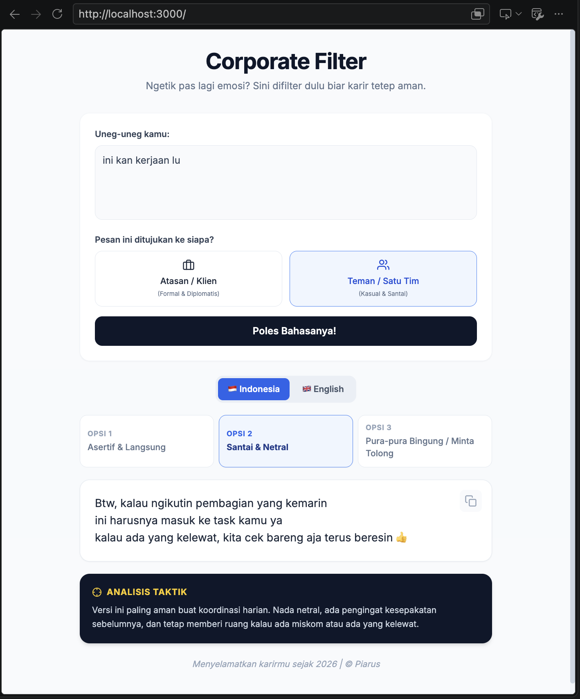
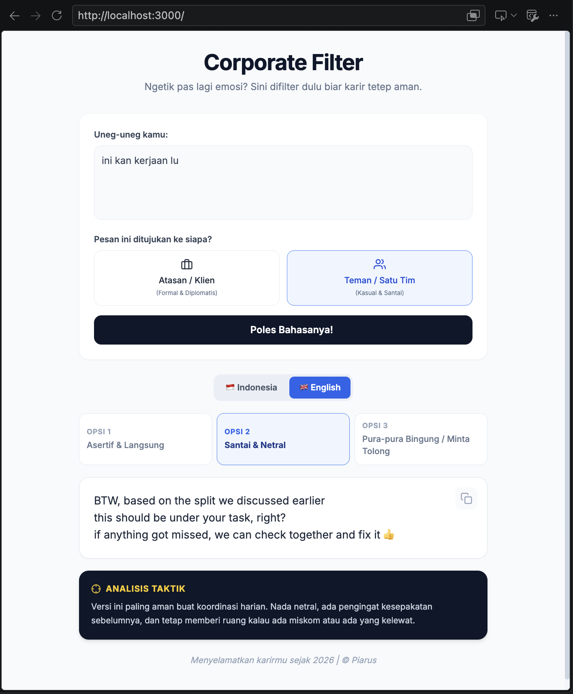

# Corporate Filter

Corporate Filter is a smart web application designed to polish harsh, impulsive, or emotional texts into safe, professional, or casual communication suitable for the workplace. This application is powered by the OpenAI API (`gpt-5.4-mini`), implementing Structured Outputs to ensure consistent JSON response formatting.

## Core Features
*   **Dual Audience Mode:** Adjusts the tone of the language for Superiors/Clients (Formal & Diplomatic) or Friends/Teammates (Casual & Relaxed).
*   **Bilingual Output:** Provides polished text in both Indonesian and English simultaneously.
*   **3 Psychological Tactics Levels:**
    *   Option 1: Firm but Polite / Firm but Chill
    *   Option 2: Diplomatic & Neutral
    *   Option 3: Soft Probing / Managing Up
*   **Tactical Analysis:** Provides the psychological rationale behind each sentence option generated by the AI.

## Tech Stack
*   **Frontend:** HTML5, Tailwind CSS (via CDN), Vanilla JavaScript, Feather Icons.
*   **Backend:** Node.js, Express.js.
*   **AI Integration:** OpenAI API (Chat Completions API).
*   **Environment Management:** `dotenv`.

## Directory Structure
```text
corporate-filter/
│
├── public/
│   ├── index.html       # Main application interface
│   └── script.js        # Client-side logic
│
├── server.js            # Express backend logic
├── package.json         # Node.js dependencies configuration
├── .env                 # Environment variables (DO NOT COMMIT)
└── README.md            # Project documentation
```

## Running Locally

### Prerequisites

Make sure you have the following installed:

* Node.js 18 or later
* An OpenAI API key

### Setup

1. Clone the repository and open the project directory.
2. Install the dependencies:

    ```bash
    npm install
    ```

3. Create a `.env` file in the project root and add your OpenAI API key:

    ```env
    OPENAI_API_KEY=your_openai_api_key
    ```

### Start the application

Run the server with:

```bash
npm run test
```

Then open [http://localhost:3000](http://localhost:3000) in your browser. To use a different port, set the `PORT` environment variable before starting the server.

<hr>
<p align="center">
<i>Preview response in Indonesian</i>
  
</p>

<p align="center">
<i>Preview response in English</i>
  
</p>
